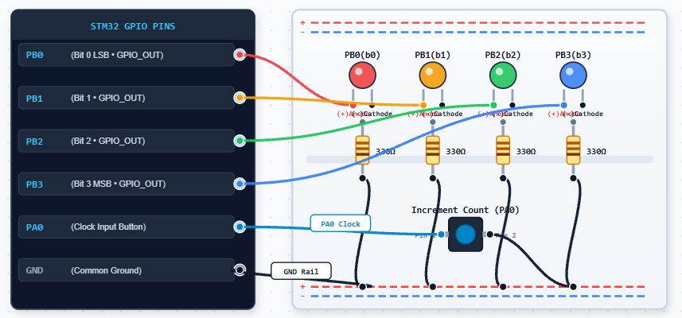

# Binary Counter Display

A 4-bit binary counter implemented using the STM32 Blue Pill microcontroller and simulated using PICSimLab. The counter increments on every button press and displays the binary value through four LEDs.

## What This Project Does

- Starts the counter at `0` with all LEDs OFF.
- Increments the counter by one whenever the push button is pressed.
- Displays the counter value in binary using four LEDs.
- Counts from `0` to `15` (0000 to 1111).
- Automatically rolls over to `0` after reaching `15`.
- Implements software button debouncing to prevent multiple counts from a single press.
- Updates all four LED outputs simultaneously using the GPIO `BSRR` register.

## Hardware / Components

| Component | Description |
|---|---|
| Blue Pill | STM32F103C8T6 microcontroller |
| PICSimLab | Hardware simulation environment |
| Push Button | Counter increment input |
| 4 LEDs | Binary counter output |
| 4 × 330Ω Resistors | LED current limiting |
| GPIO | Input and output interfacing |

## Pin Configuration

| STM32 Pin | Configuration | Function |
|---|---|---|
| PA0 | GPIO Input | Push button / counter input |
| PB0 | GPIO Output | Binary bit 0 (LSB) |
| PB1 | GPIO Output | Binary bit 1 |
| PB2 | GPIO Output | Binary bit 2 |
| PB3 | GPIO Output | Binary bit 3 (MSB) |

## Working Principle

1. The counter is initialized to `0`.
2. All four LEDs are initially turned OFF.
3. The program continuously reads the push button connected to PA0.
4. Button state changes are monitored using `HAL_GetTick()`.
5. A 30 ms debounce interval is used to filter unwanted button transitions.
6. When a stable button press is detected (active-low), the counter is incremented.
7. The counter is restricted to four bits using a bitwise mask.
8. The counter value is converted into its binary representation.
9. The four LED outputs are updated simultaneously using the GPIO `BSRR` register.
10. After reaching `15`, the counter rolls over to `0`.

## Implementation Details

### Counter Initialization

The counter starts at zero:

```c
int count = 0;
```

All four LED outputs are initially reset:

```c
GPIOB->BSRR = 0x0F << 16;
```

### Button Debouncing

The program uses `HAL_GetTick()` to track button state changes and implement a 30 ms debounce interval.

```c
if(button != prv_button)
{
    prv_button = button;
    debounce = time;
}

if((time - debounce) >= 30)
{
    if(button != stable_button)
    {
        stable_button = button;
    }
}
```

This helps prevent mechanical button bouncing from causing multiple counter increments from a single press.

### Counter Increment and 4-Bit Limitation

```c
count = (count + 1) & 0x0F;
```

The bitwise AND operation with `0x0F` ensures that the counter remains within the range of `0` to `15`.

### Simultaneous LED Update

```c
GPIOB->BSRR = ((~count & 0x0F) << 16) | (count & 0x0F);
```

The GPIO `BSRR` register is used to set and reset the four LED output pins in a single register write, allowing the binary output to be updated simultaneously.

## Binary Counter Output

| Decimal | Binary | PB3 | PB2 | PB1 | PB0 |
|---:|:---:|:---:|:---:|:---:|:---:|
| 0 | 0000 | OFF | OFF | OFF | OFF |
| 1 | 0001 | OFF | OFF | OFF | ON |
| 2 | 0010 | OFF | OFF | ON | OFF |
| 3 | 0011 | OFF | OFF | ON | ON |
| 4 | 0100 | OFF | ON | OFF | OFF |
| 5 | 0101 | OFF | ON | OFF | ON |
| 6 | 0110 | OFF | ON | ON | OFF |
| 7 | 0111 | OFF | ON | ON | ON |
| 8 | 1000 | ON | OFF | OFF | OFF |
| 9 | 1001 | ON | OFF | OFF | ON |
| 10 | 1010 | ON | OFF | ON | OFF |
| 11 | 1011 | ON | OFF | ON | ON |
| 12 | 1100 | ON | ON | OFF | OFF |
| 13 | 1101 | ON | ON | OFF | ON |
| 14 | 1110 | ON | ON | ON | OFF |
| 15 | 1111 | ON | ON | ON | ON |

## Images & Simulation Results

### STM32 Pin Configuration

<p align="center">
  
</p>

### Circuit Diagram

<p align="center">
  
</p>

## Concepts Demonstrated

- Embedded C programming
- STM32 GPIO configuration
- GPIO input and output handling
- Binary number representation
- Bitwise operations
- Bit masking
- Hardware register programming
- GPIO `BSRR` register
- Button debouncing
- `HAL_GetTick()` time-based logic
- Counter rollover
- Simultaneous GPIO output updates
