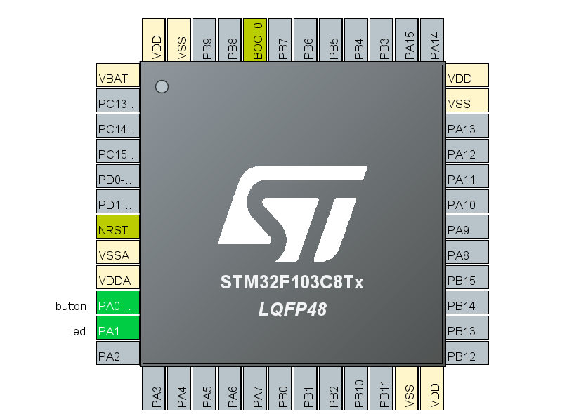
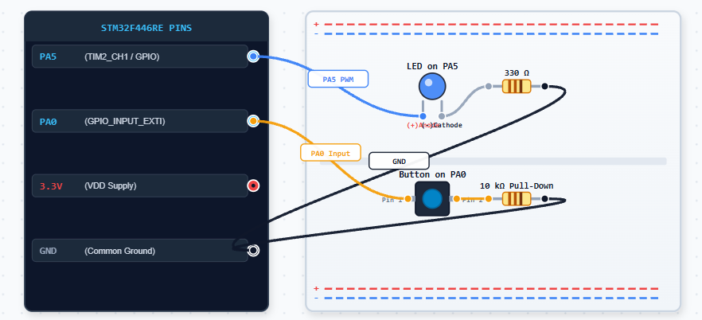
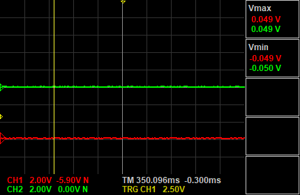
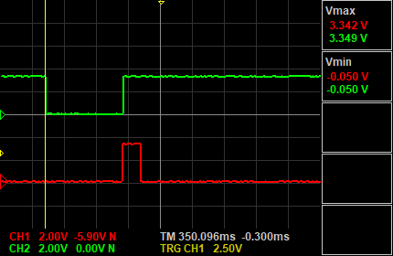
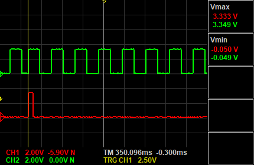
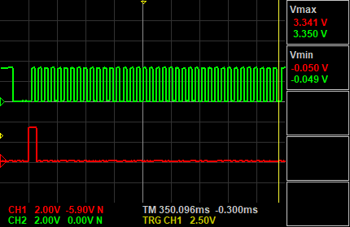

# Multi-Mode LED Controller

A four-mode LED controller implemented using the STM32 Blue Pill microcontroller. The operating mode is selected using a push button, with the LED supporting constant OFF, constant ON, slow blinking, and fast blinking modes.

## What This Project Does

- Starts in Mode 0 with the LED OFF.
- Advances to the next operating mode with each valid button press.
- Supports four modes in a cyclic sequence.
- Provides constant OFF and constant ON states.
- Generates slow blinking at 1 Hz.
- Generates fast blinking at 5 Hz.
- Uses `HAL_GetTick()` for non-blocking time-based LED control.
- Uses an enumerated data type to represent the operating modes.

## Hardware / Components

| Component | Description |
|---|---|
| Blue Pill | STM32F103C8T6 microcontroller |
| PICSimLab | Hardware simulation environment |
| Push Button | Operating mode selection input |
| LED | Mode-dependent output indicator |
| GPIO | Digital input and output interfacing |

## Pin Configuration

| STM32 Pin | Configuration | Function |
|---|---|---|
| PA0 | GPIO Input | Push button / mode selection |
| PA1 | GPIO Output | LED control output |
| PA5 | GPIO Output write in transition logic | Additional output write in the current implementation |

> **Note:** PA1 is used in the main mode-control `switch` statement. PA5 is also written during mode transitions in the current code. Verify whether PA5 is intentional or leftover logic before finalizing the pin configuration.

## Operating Modes

| Mode | Operation | LED Behavior | Timing |
|---|---|---|---|
| Mode 0 | Constant OFF | LED remains OFF | — |
| Mode 1 | Constant ON | LED remains ON | — |
| Mode 2 | Slow Blink | LED alternates ON and OFF | 500 ms per state |
| Mode 3 | Fast Blink | LED alternates ON and OFF | 100 ms per state |

### Mode Sequence

The operating modes follow a cyclic sequence:

```text
MODE 0: OFF
    ↓ Button Press
MODE 1: ON
    ↓ Button Press
MODE 2: SLOW BLINK
    ↓ Button Press
MODE 3: FAST BLINK
    ↓ Button Press
MODE 0: OFF
```

## Working Principle

1. The controller initializes in `MODE_OFF`.
2. The push button connected to PA0 is continuously monitored.
3. Button state changes are processed using a 30 ms time interval.
4. A valid rising-edge button transition advances the operating mode.
5. The mode is updated using cyclic logic.
6. The LED output is controlled according to the current mode.
7. In blinking modes, `HAL_GetTick()` is used to track elapsed time.
8. The LED state is toggled when the configured interval expires.
9. The controller continuously repeats this process without using blocking delay functions.

## Implementation Details

### Mode Enumeration

An enumerated data type is used to represent the four operating modes.

```c
typedef enum
{
    MODE_OFF,
    MODE_ON,
    MODE_BLINK_500MS,
    MODE_BLINK_100MS

} LED_Mode;

LED_Mode mode = MODE_OFF;
```

This improves code readability by assigning descriptive names to the operating states.

### Cyclic Mode Selection

```c
mode = (mode + 1) % 4;
```

The modulo operation ensures that the mode advances through the four states and returns to Mode 0 after Mode 3.

### Button Input and Mode Selection

```c
if ((current_time - debounce_time) >= 30)
{
    debounce_time = current_time;

    if (current_button == GPIO_PIN_SET &&
        previous_button == GPIO_PIN_RESET)
    {
        mode = (mode + 1) % 4;
    }

    previous_button = current_button;
}
```

The button input is checked at 30 ms intervals. A rising-edge transition from RESET to SET advances the operating mode.

### Non-Blocking Slow Blink

```c
case MODE_BLINK_500MS:

    if ((current_time - previous_time) >= 500)
    {
        previous_time = current_time;
        HAL_GPIO_TogglePin(GPIOA, GPIO_PIN_1);
    }

    break;
```

The LED toggles every 500 ms, resulting in:

- 500 ms HIGH
- 500 ms LOW
- 1 second total period
- 1 Hz frequency
- 50% duty cycle

### Non-Blocking Fast Blink

```c
case MODE_BLINK_100MS:

    if ((current_time - previous_time) >= 100)
    {
        previous_time = current_time;
        HAL_GPIO_TogglePin(GPIOA, GPIO_PIN_1);
    }

    break;
```

The LED toggles every 100 ms, resulting in:

- 100 ms HIGH
- 100 ms LOW
- 200 ms total period
- 5 Hz frequency
- 50% duty cycle

## Images & Simulation Results

### STM32 Pin Configuration

<p align="center">
  
</p>

### Circuit Diagram

<p align="center">
  
</p>

### Simulation Results

<!-- Add simulation screenshots showing the four operating modes -->

<p align="center">
  
  
</p>

<p align="center">
  
  
</p>

## Concepts Demonstrated

- Embedded C programming
- STM32 GPIO configuration
- GPIO input and output handling
- Enumerations (`enum`)
- State machine design
- Cyclic mode selection
- Button edge detection
- Software debounce timing
- Non-blocking programming
- `HAL_GetTick()` time-based control
- LED toggling
- Frequency and duty-cycle concepts
- Modular programming logic

## Challenges & Solutions

| Challenge | Solution |
|---|---|
| Managing multiple LED operating modes | Used an enumerated type to represent the four modes |
| Cycling through modes without exceeding the mode range | Used modulo-based mode selection |
| Generating different blink frequencies | Used elapsed-time checks with `HAL_GetTick()` |
| Avoiding blocking delays during blinking | Implemented non-blocking timer-based logic |
| Detecting button transitions | Compared current and previous button states |

## Future Improvements

- Implement a more robust debounce algorithm using stable-state tracking.
- Ensure LED output transitions immediately when changing modes.
- Remove or verify the additional PA5 output write.
- Implement a dedicated state-machine structure.
- Add interrupt-based button detection.
- Add a reset functionality.
- Verify output frequency using a logic analyzer or oscilloscope.
