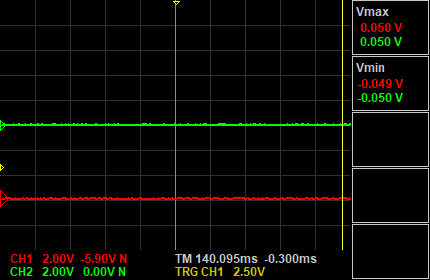
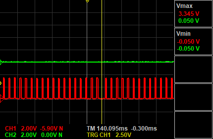
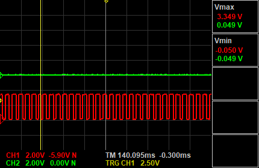
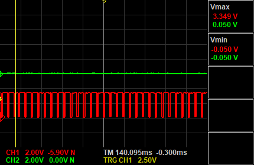
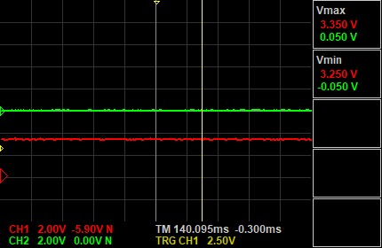

# PWM-Based LED Brightness Controller

**Level:** Beginner | **Platform:** STM32 Blue Pill

A PWM-based LED brightness controller implemented using the STM32F103C8T6 microcontroller. LED brightness is adjusted in 20% increments through push-button input, using timer-based PWM signal generation.

## What This Project Does

- Starts with the LED at 0% brightness (OFF).
- Increases brightness by 20% with each valid button press.
- Supports brightness levels from 0% to 100%.
- Automatically resets brightness to 0% after reaching 100%.
- Generates PWM signals using Timer 2, Channel 1.
- Controls LED brightness by adjusting the PWM duty cycle.
- Implements falling-edge button detection and software debouncing.

### Brightness Sequence

```text
0% → 20% → 40% → 60% → 80% → 100%
 ↑                                      |
 └──────────── Next Press ──────────────┘
```

## Hardware / Components

| Component                 | Description                      |
| ------------------------- | -------------------------------- |
| Blue Pill                 | STM32F103C8T6 microcontroller    |
| PICSimLab                 | Hardware simulation environment  |
| Push Button               | Brightness adjustment input      |
| LED                       | PWM-controlled brightness output |
| Current-Limiting Resistor | LED current protection           |

## Pin Configuration

| STM32 Pin | Configuration         | Function               |
| --------- | --------------------- | ---------------------- |
| PA1       | GPIO Input (Pull-up)  | Push button input      |
| PA0       | TIM2_CH1 (PWM Output) | LED brightness control |

## Working Principle

1. Initialize the STM32 GPIO and TIM2 peripherals.
2. Start TIM2 Channel 1 in PWM mode.
3. Set the initial brightness to 0%.
4. Continuously monitor the push button connected to PA1.
5. Detect a falling-edge transition when the active-low button is pressed.
6. Apply a 100 ms debounce lockout to prevent unwanted multiple increments.
7. Increase brightness by 20% for each valid button press.
8. Calculate the corresponding PWM pulse value.
9. Update the Capture/Compare Register (CCR) to adjust the PWM duty cycle.
10. After reaching 100%, the next valid button press resets brightness to 0%.

## Implementation Details

### PWM Configuration

Timer 2, Channel 1 is configured to generate the PWM signal.

| Parameter                      | Function                      |
| ------------------------------ | ----------------------------- |
| Timer                          | TIM2                          |
| Channel                        | Channel 1                     |
| PWM Output                     | PA0                           |
| Prescaler (PSC)                | Controls timer clock division |
| Auto-Reload Register (ARR)     | Determines PWM period         |
| Capture/Compare Register (CCR) | Controls PWM duty cycle       |

### PWM Initialization

PWM generation is started before entering the infinite loop, with the initial duty cycle set to zero.

```c
HAL_TIM_PWM_Start(&htim2, TIM_CHANNEL_1);
__HAL_TIM_SET_COMPARE(&htim2, TIM_CHANNEL_1, 0);
```

### Brightness Control

The brightness level increases in 20% increments.

```c
if (brightness >= 100)
{
    brightness = 0;
}
else
{
    brightness += 20;
}
```

### PWM Pulse Calculation

The PWM pulse value is calculated based on the selected brightness level.

```c
uint32_t pulse = (brightness * 1000) / 100;

__HAL_TIM_SET_COMPARE(&htim2, TIM_CHANNEL_1, pulse);
```

With ARR = 999, the corresponding compare values are:

| Brightness | CCR Value | LED Output             |
| ---------: | --------: | ---------------------- |
|         0% |         0 | OFF                    |
|        20% |       200 | Low brightness         |
|        40% |       400 | Medium-low brightness  |
|        60% |       600 | Medium-high brightness |
|        80% |       800 | High brightness        |
|       100% |      1000 | Maximum brightness     |

### PWM Duty Cycle Calculation

The PWM duty cycle determines the percentage of time the output signal remains HIGH during one PWM period.

[
Duty\ Cycle(%) = \frac{CCR}{ARR+1}\times100
]

The Capture/Compare Register (CCR) is updated according to the selected brightness level.

### Button Debouncing

- Push button is configured with an internal pull-up.
- Button press is detected through a falling-edge transition.
- `HAL_GetTick()` is used to measure elapsed time.
- A 100 ms debounce lockout prevents unwanted multiple brightness increments.

## Images & Simulation Results

## Images & Simulation Results

### STM32 Blue Pill Pin Configuration


---

### PWM Output Waveforms

<p align="center">
  <b>0% Brightness</b> &nbsp;&nbsp;&nbsp;&nbsp;&nbsp;&nbsp;&nbsp;
  <b>20% Brightness</b><br>
  
  
</p>

<br>

<p align="center">
  <b>40% Brightness</b> &nbsp;&nbsp;&nbsp;&nbsp;&nbsp;&nbsp;&nbsp;
  <b>60% Brightness</b><br>
  
  
</p>

<br>

<p align="center">
  <b>80% Brightness</b> &nbsp;&nbsp;&nbsp;&nbsp;&nbsp;&nbsp;&nbsp;
  <b>100% Brightness</b><br>
  
  
</p>

## Concepts Demonstrated

- Embedded C programming
- STM32 GPIO configuration
- PWM (Pulse Width Modulation)
- Timer configuration (TIM2)
- Timer Channel configuration
- Duty cycle control
- Capture/Compare Register (CCR)
- Auto-Reload Register (ARR)
- Push-button interfacing
- Falling-edge detection
- Software debouncing
- HAL library
- Hardware timer-based signal generation
