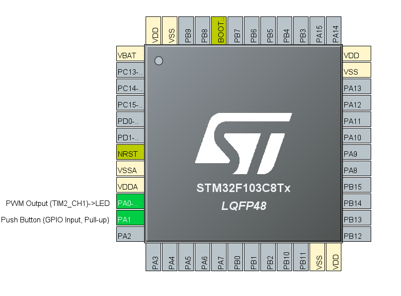
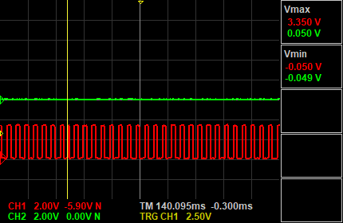

# PWM-Based LED Brightness Controller

**Level:** Beginner | **Platform:** STM32 Blue Pill

A PWM-based LED brightness controller implemented using the STM32F103C8T6 microcontroller. LED brightness is adjusted in 10% increments through push-button input, using timer-based PWM signal generation.

## What This Project Does

- Starts with the LED at 0% brightness (OFF).
- Increases brightness by 10% with each valid button press.
- Supports brightness levels from 0% to 100%.
- Automatically resets brightness to 0% after reaching 100%.
- Generates PWM signals using Timer 2, Channel 1.
- Controls LED brightness by adjusting the PWM duty cycle.
- Implements button press detection and software debouncing.

### Brightness Sequence

```text
0% → 10% → 20% → 30% → 40% → 50%
 ↑                                ↓
100% ← 90% ← 80% ← 70% ← 60%
```

## Hardware / Components

| Component                 | Description                      |
| ------------------------- | -------------------------------- |
| Blue Pill                 | STM32F103C8T6 microcontroller    |
| PICSimLab                 | Hardware simulation environment  |
| Push Button               | Brightness adjustment input      |
| LED                       | PWM-controlled brightness output |
| Current-Limiting Resistor | LED current protection           |

## Pin Configuration

| STM32 Pin | Configuration         | Function               |
| --------- | --------------------- | ---------------------- |
| PA1       | GPIO Input (Pull-up)  | Push button input      |
| PA0       | TIM2_CH1 (PWM Output) | LED brightness control |

## Working Principle

1. Initialize the STM32 GPIO and TIM2 peripherals.
2. Configure TIM2 Channel 1 in PWM mode.
3. Initialize the brightness level to 0%.
4. Continuously monitor the push button connected to PA1.
5. Apply software debouncing to detect valid button presses.
6. Increase the brightness level by 10% for each valid press.
7. Calculate the corresponding PWM duty cycle.
8. Update the timer compare register (`CCR`) to adjust the PWM output.
9. Once the brightness reaches 100%, the next valid press resets it to 0%.
10. Repeat the process continuously.

## Implementation Details

### PWM Configuration

Timer 2, Channel 1 is configured to generate the PWM signal.

| Parameter                      | Function                      |
| ------------------------------ | ----------------------------- |
| Timer                          | TIM2                          |
| Channel                        | Channel 1                     |
| PWM Output                     | PA0                           |
| Prescaler (PSC)                | Controls timer clock division |
| Auto-Reload Register (ARR)     | Determines PWM period         |
| Capture/Compare Register (CCR) | Controls PWM duty cycle       |

### Brightness Control

The brightness level is increased in 10% increments:

```text
0%, 10%, 20%, 30%, 40%,
50%, 60%, 70%, 80%, 90%, 100%
```

### PWM Duty Cycle Calculation

The PWM duty cycle determines the percentage of time the output signal remains HIGH during one PWM period.

[
Duty\ Cycle(%) = \frac{CCR}{ARR+1}\times100
]

The compare register is updated according to the selected brightness level.

### Button Debouncing

Software debouncing is implemented to prevent unwanted multiple brightness increments caused by mechanical button bouncing.

## Images & Simulation Results

## Images & Simulation Results

### STM32 Blue Pill Pin Configuration



---

### PWM Output Waveforms

The following waveform captures demonstrate PWM output behavior at different brightness levels.

**PWM Output 1**


**PWM Output 2**


**PWM Output 3**



**PWM Output 4**


**PWM Output 5**


**PWM Output 6**


<p align="center">
  
  
</p>

<p align="center">
  
  
</p>

pwm-output-1.png

## Concepts Demonstrated

- Embedded C programming
- STM32 GPIO configuration
- PWM (Pulse Width Modulation)
- Timer configuration (TIM2)
- Timer Channel configuration
- Duty cycle control
- Capture/Compare Register (CCR)
- Auto-Reload Register (ARR)
- Push-button interfacing
- Software debouncing
- HAL library
- Hardware timer-based signal generation

## Challenges & Solutions

| Challenge                                            | Solution                                    |
| ---------------------------------------------------- | ------------------------------------------- |
| Generating a stable PWM signal                       | Configured TIM2 Channel 1 in PWM mode       |
| Adjusting LED brightness                             | Modified the timer compare register (`CCR`) |
| Converting brightness levels into PWM output         | Used duty-cycle calculation                 |
| Preventing multiple increments from one button press | Implemented software debouncing             |
| Handling brightness rollover                         | Reset brightness from 100% to 0%            |

## Future Improvements

- Implement ADC-based brightness control using a potentiometer.
- Add smooth LED fading transitions.
- Control multiple LEDs independently using different PWM channels.
- Implement interrupt-based button handling.
- Add UART-based brightness monitoring.
