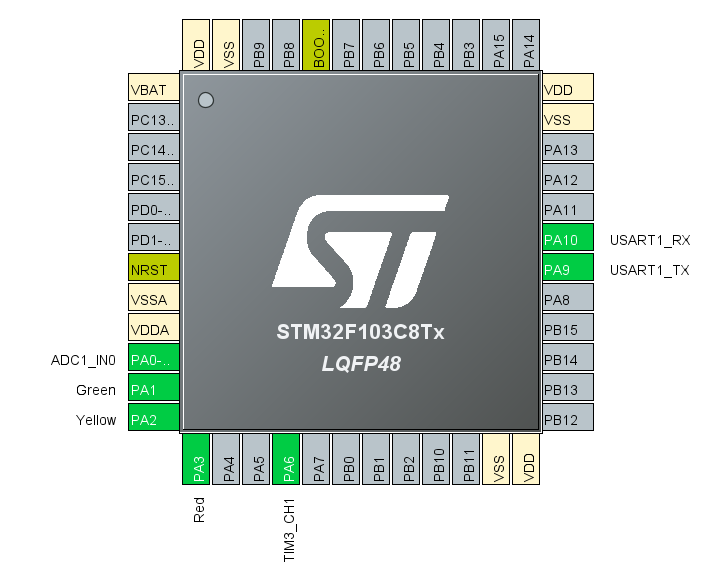
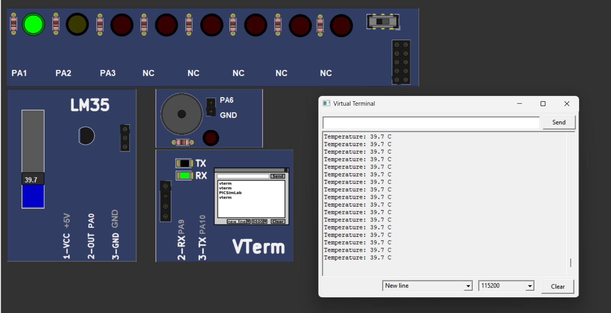
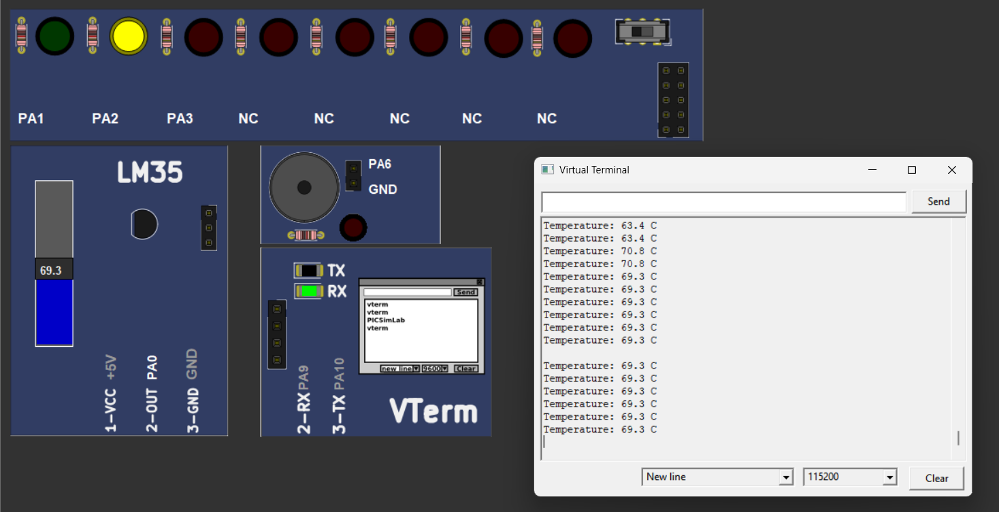
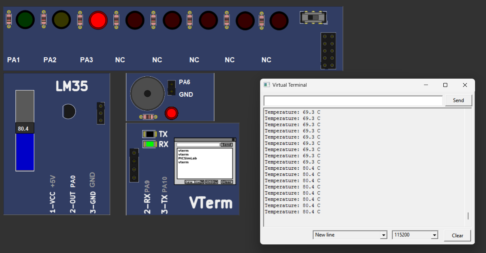

# Temperature Monitoring System

**Level:** Beginner | **Platform:** STM32 Blue Pill

A temperature monitoring system implemented using the STM32F103C8T6 microcontroller and LM35 temperature sensor. The system measures temperature using ADC, displays temperature status through LEDs, activates a buzzer at high temperatures, and transmits temperature readings through UART.

## What This Project Does

- Reads analog temperature data from the LM35 sensor.
- Converts ADC readings into temperature values in Celsius.
- Monitors temperature continuously.
- Divides temperature into three operating ranges.
- Uses three LEDs to indicate low, normal, and high temperature conditions.
- Activates a buzzer when the temperature exceeds 70°C.
- Transmits real-time temperature readings through UART.
- Updates the temperature reading every 100 ms.

### Temperature Monitoring Conditions

| Temperature Range | Status | LED Indication | Buzzer |
|---|---|---|---|
| Below 40°C | Low Temperature | PA1 ON | OFF |
| 40°C – 70°C | Normal Temperature | PA2 ON | OFF |
| Above 70°C | High Temperature | PA3 ON | ON |

## Hardware / Components

| Component | Description |
|---|---|
| Blue Pill | STM32F103C8T6 microcontroller |
| PICSimLab | Hardware simulation environment |
| LM35 | Analog temperature sensor |
| 3 LEDs | Temperature status indication |
| Buzzer | High-temperature alert |
| UART Terminal | Displays temperature readings |
| ADC | Analog temperature data acquisition |

## Pin Configuration

| STM32 Pin | Configuration | Function |
|---|---|---|
| PA0 | ADC Input (ADC1_IN0) | LM35 analog output |
| PA1 | GPIO Output | Low-temperature indicator |
| PA2 | GPIO Output | Normal-temperature indicator |
| PA3 | GPIO Output | High-temperature indicator |
| PA6 | GPIO Output | Buzzer control |
| PA9 | USART1_TX | UART temperature transmission |
| PA10 | USART1_RX | UART receive pin |

## Working Principle

1. Initialize ADC, GPIO, and UART peripherals.
2. Start ADC conversion to acquire analog data from the LM35 sensor.
3. Read the ADC conversion result.
4. Convert the ADC value into voltage.
5. Calculate the corresponding temperature in Celsius.
6. Transmit the temperature reading through UART1.
7. Compare the calculated temperature against predefined thresholds.
8. Activate the corresponding LED based on the temperature range.
9. Activate the buzzer when the temperature exceeds 70°C.
10. Repeat the monitoring process with a 100 ms delay.

## Implementation Details

### ADC Initialization and Data Acquisition

ADC is used to read the analog output of the LM35 temperature sensor.

```c
HAL_ADC_Start(&hadc1);

HAL_ADC_PollForConversion(&hadc1, 100);

uint32_t value = HAL_ADC_GetValue(&hadc1);
```

The ADC conversion result is obtained using `HAL_ADC_GetValue()`.

### Temperature Calculation

The ADC value is converted into temperature using the following formula:

```c
temp = (value * 3.3 * 100) / 4095;
```

Where:

- `value` – 12-bit ADC reading (0–4095).
- `3.3` – ADC reference voltage.
- `100` – LM35 conversion factor (10 mV/°C).
- `4095` – Maximum 12-bit ADC value.

### UART Temperature Transmission

Temperature readings are transmitted through USART1 using `HAL_UART_Transmit()`.

```c
char buffer[32];

sprintf(buffer, "Temperature: %.1f C\r\n", temp);

len = strlen(buffer);

HAL_UART_Transmit(&huart1, (uint8_t *)buffer, len, 100);
```

The serial terminal displays the temperature continuously in Celsius.

### Temperature-Based LED Control

The system uses three temperature ranges to control the LED indicators.

**Low Temperature (< 40°C)**

```c
if(temp < 40)
{
    HAL_GPIO_WritePin(GPIOA, GPIO_PIN_1, GPIO_PIN_SET);
    HAL_GPIO_WritePin(GPIOA, GPIO_PIN_2, GPIO_PIN_RESET);
    HAL_GPIO_WritePin(GPIOA, GPIO_PIN_3, GPIO_PIN_RESET);
    HAL_GPIO_WritePin(GPIOA, GPIO_PIN_6, GPIO_PIN_RESET);
}
```

PA1 LED is activated to indicate low temperature.

**Normal Temperature (40°C – 70°C)**

```c
else if(temp >= 40 && temp <= 70)
{
    HAL_GPIO_WritePin(GPIOA, GPIO_PIN_1, GPIO_PIN_RESET);
    HAL_GPIO_WritePin(GPIOA, GPIO_PIN_2, GPIO_PIN_SET);
    HAL_GPIO_WritePin(GPIOA, GPIO_PIN_3, GPIO_PIN_RESET);
    HAL_GPIO_WritePin(GPIOA, GPIO_PIN_6, GPIO_PIN_RESET);
}
```

PA2 LED is activated to indicate normal temperature.

**High Temperature (> 70°C)**

```c
else if(temp > 70)
{
    HAL_GPIO_WritePin(GPIOA, GPIO_PIN_1, GPIO_PIN_RESET);
    HAL_GPIO_WritePin(GPIOA, GPIO_PIN_2, GPIO_PIN_RESET);
    HAL_GPIO_WritePin(GPIOA, GPIO_PIN_3, GPIO_PIN_SET);
    HAL_GPIO_WritePin(GPIOA, GPIO_PIN_6, GPIO_PIN_SET);
}
```

PA3 LED and the buzzer connected to PA6 are activated to indicate high temperature.

### Monitoring Interval

```c
HAL_Delay(100);
```

The temperature monitoring loop executes with a 100 ms delay between iterations.

## Images & Simulation Results

### STM32 Blue Pill Pin Configuration



### Temperature Monitoring Outputs

The following simulation captures demonstrate the three temperature conditions and their corresponding LED and buzzer responses.

| **Low Temperature (< 40°C)** | **Normal Temperature (40–70°C)** |
|:---:|:---:|
|  |  |

| **High Temperature (> 70°C)** |
|:---:|
|  |

## Concepts Demonstrated

- Embedded C programming
- STM32 GPIO configuration
- ADC configuration and data acquisition
- 12-bit ADC resolution
- Analog sensor interfacing
- LM35 temperature measurement
- ADC-to-voltage conversion
- Temperature calculation
- UART communication
- Serial data transmission
- Conditional statements
- GPIO-based status indication
- Buzzer interfacing
- HAL library
- Periodic sensor monitoring

## Challenges & Solutions

| Challenge | Solution |
|---|---|
| Reading analog temperature data | Configured ADC to acquire LM35 sensor output |
| Converting ADC values into temperature | Implemented ADC-to-voltage and temperature conversion |
| Monitoring different temperature conditions | Used conditional statements with defined temperature thresholds |
| Displaying temperature readings | Implemented UART communication using `HAL_UART_Transmit()` |
| Generating high-temperature alerts | Activated the buzzer when temperature exceeded 70°C |

## Future Improvements

- Implement moving average filtering to reduce ADC noise.
- Add configurable temperature thresholds.
- Display temperature readings on an LCD or OLED.
- Implement UART-based temperature configuration.
- Add temperature logging for historical monitoring.
- Implement interrupt-based ADC conversion.
